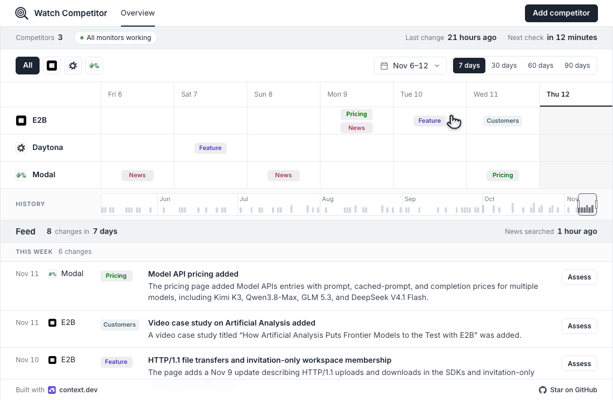
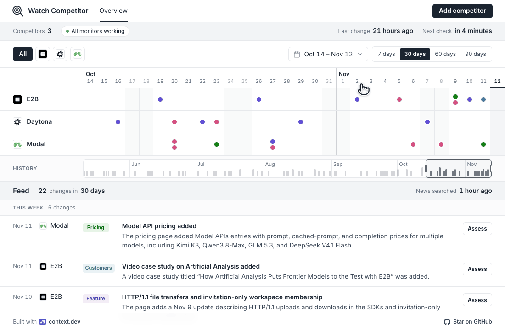

<div align="center">
  <picture>
    <source media="(prefers-color-scheme: dark)" srcset="public/watch-competitor-logo-dark.png">
    
  </picture>
  <h1>Watch Competitor</h1>
  <p><strong>Watch your competitors' pricing changes, feature launches and news, and respond with your AI agent.</strong><br>
  An open source, self-hosted alternative to Crayon, Klue and Kompyte. Free and easy to customize.</p>
  <p>
    <a href="https://watch-competitor.vercel.app">Live demo</a> ·
    <a href="#features">Features</a> ·
    <a href="#get-started">Get started</a> ·
    <a href="#build-on-it">Build on it</a>
  </p>

[](https://context.dev/?utm_source=watch-competitor&utm_medium=readme&utm_campaign=open-source)
[](LICENSE)

</div>

[](https://watch-competitor.vercel.app)

Watch Competitor monitors your competitors' pricing changes, feature launches, news and any other key pages you choose. It alerts you to changes and turns them into prompts for your AI agent.

## Features

- **One timeline.** See every competitor's pricing changes, feature launches and news in one timeline, over any date range.
- **Easy-to-read changes.** Each change comes as a short summary, or as the before and after of what changed.
- **Assess and act.** Assess any change in one click and get a prompt for your AI agent. It offers tasks that fit the change, such as updating your comparison page.
- **Custom monitoring.** Narrow monitoring to what matters to you, such as "Only report changes about sandboxes".
- **Monitor any key pages.** Add their careers, customers, security or blog page, or any other page on their site.
- **Slack alerts.** Get new changes posted to your Slack channel.

[](https://watch-competitor.vercel.app)

## Get started

**Try it** on the [live demo](https://watch-competitor.vercel.app). The demo lets you look up any company. Deploy your own copy to start watching them.

**Run it on your computer.** You need Node.js 20.9 or later and an API key from [context.dev](https://context.dev/?utm_source=watch-competitor&utm_medium=readme&utm_campaign=open-source).

```bash
git clone https://github.com/jacksonllk/watch-competitor.git
cd watch-competitor
cp .env.example .env
```

Add your API key to `.env`, then start the app:

```bash
npm install
npm run dev
```

The app runs at http://localhost:3000.

### Deploy your own

Deploy to Vercel with one click:

[](https://vercel.com/new/clone?repository-url=https%3A%2F%2Fgithub.com%2Fjacksonllk%2Fwatch-competitor&project-name=watch-competitor&env=CONTEXT_DEV_API_KEY&envDescription=Your+context.dev+API+key.+Restricted+keys+need+Data+APIs+%28use%29+and+Monitors+%28manage%29.&envLink=https%3A%2F%2Fcontext.dev&stores=%5B%7B%22type%22%3A%22integration%22%2C%22integrationSlug%22%3A%22upstash%22%2C%22productSlug%22%3A%22upstash-kv%22%7D%5D)

Watch Competitor is a standard Next.js app, so it also runs on any other host with Node.js 20.9 or later. Set your API key and any optional settings from [`.env.example`](.env.example), such as Slack alerts. Then build and start it:

```bash
npm install
npm run build
npm start
```

The app saves its data to a local file, or to Upstash Redis when you set its variables.

## Build on it

**Change how it works.** These are plain files:

| To change | Edit |
|---|---|
| The Assess prompts and tasks | [`prompts/`](prompts/README.md) |
| What a check reports, how often it runs, Slack alerts | `watch-competitor.config.json` ([defaults](lib/config.ts)) |
| The extra page types and what each reports | [`lib/page-types.ts`](lib/page-types.ts) |

**Take it further.**

- Add sign-in and accounts, so each team sees only its own competitors.
- Give each customer their own API key, or meter their usage.
- Send alerts by email as well as Slack.

## Limitations

- Prices behind a tab or toggle, such as annual billing, are not watched. A check reads the page as it first shows.
- A change shows when the daily check finds it, up to a day later. Pricing history starts the day you add a competitor.
- Customers pages report additions only, because older case studies often hide behind "Load more".
- News comes from the outlets the news search covers. Small companies may have little coverage.

## Contributing

See [CONTRIBUTING.md](CONTRIBUTING.md).

## License

MIT. See [LICENSE](LICENSE).
